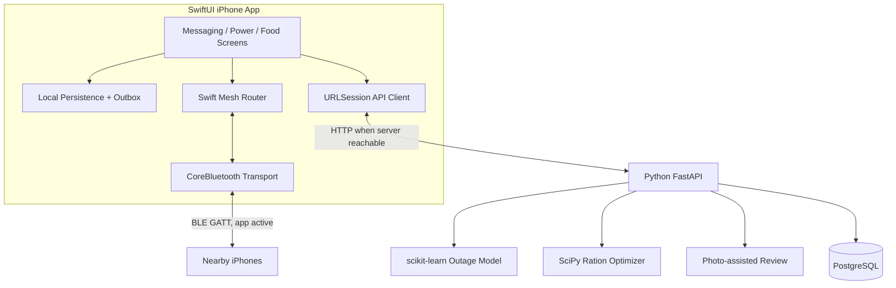
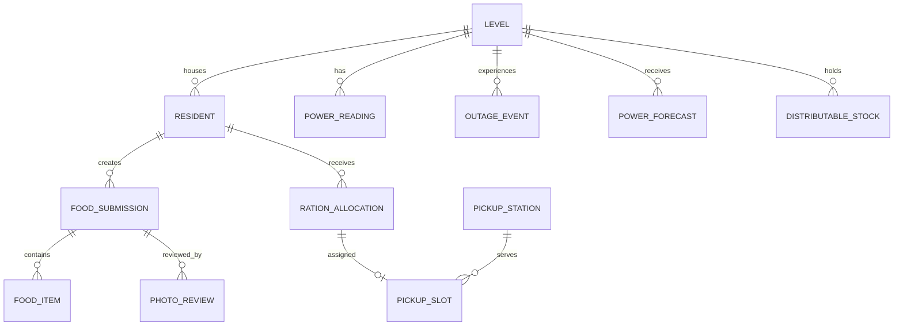

# Hollow — Offline Survival Network

**Status:** Proposed one-week hackathon prototype; features below are specifications, not claims of completed functionality.

Hollow is an **iPhone-first** survival coordination application for an underground civilization with unreliable power, scarce food, and disrupted connectivity. It combines (1) nearby device-to-device messaging, (2) level-specific power outage forecasting, and (3) food inventory, allocation, and pickup scheduling.

## Technology

| Layer | Choice |
| --- | --- |
| iPhone UI | **Swift 5+ and SwiftUI** |
| Device-to-device transport | **CoreBluetooth** (`CBCentralManager`, `CBPeripheralManager`, GATT services/characteristics) |
| Routing | Custom Swift store-and-forward mesh protocol |
| Local storage | SwiftData or SQLite; choose one during implementation |
| Backend HTTP API | **Python 3.11+ / FastAPI / Pydantic** |
| Database | PostgreSQL + SQLAlchemy + Alembic |
| Outage forecasting | pandas, NumPy, scikit-learn |
| Food allocation | Python, SciPy optimization |
| Photo review | Vision-capable model accessed by FastAPI; human review for uncertainty |
| HTTP client | Swift `URLSession` with Codable JSON models |

**Cost and platform:** CoreBluetooth and SwiftUI have no separate Bluetooth API fee. Native iOS builds require **macOS and Xcode**. The team currently has Windows and an iPhone: obtain access to a Mac (borrowed or remote) to compile and deploy. Xcode can install development builds on a personal device using a free Apple account subject to signing/provisioning restrictions; some distribution workflows require paid Apple Developer Program membership. Python/FastAPI can run on Windows.

## System architecture



**Offline boundary:** BLE messaging works without internet or FastAPI. Prediction, vision review, and global allocation need access to a reachable FastAPI server unless a separately implemented local fallback exists. A Bluetooth peer link does **not** automatically provide HTTP connectivity to the Python server. Cached predictions, assignments, and submissions remain readable offline; pending writes synchronize once network access returns.

## Features

### 1. Nearby messaging

- Advertise a custom BLE service UUID and scan for participating iPhones.
- Exchange short messages using a GATT service with characteristics for sending and receiving.
- Route messages over intermediate peers using store-and-forward flooding for the prototype.
- Every message includes `id`, `originId`, `destinationId`, `createdAt`, `ttl`, `hopCount`, and `payload`.
- Deduplicate received IDs, decrement TTL, persist undelivered messages, and retry on peer discovery.
- Show `queued`, `sent_to_peer`, and `delivered` separately; end-to-end delivery requires a destination acknowledgment.
- Define payload-size limits and chunk/reassemble larger messages; avoid transmitting images over the first BLE prototype.
- Do not promise always-on mesh behavior: iOS limits background scanning, advertising, and execution. Demo with app foregrounded on **at least three physical iPhones** for a true two-hop test. One iPhone supports only partial local testing.

### 2. Predict power outages by underground level

**Inputs:** level ID, timestamped electrical consumption/capacity, historical outage start/end times, recent load trends, hour/day, and optional population data.

**Output:** per-level probability of an outage in the next 24 hours, risk window, and optionally estimated duration (separate model). Avoid unsupported exact outage timestamps.

**Pipeline:** import and validate historical data → time-aware features → chronological train/validation split → train scikit-learn classifier (start with histogram gradient boosting) → evaluate precision/recall and calibration → persist versioned model → serve inference via FastAPI.

**Example:** `GET /api/v1/levels/{level_id}/power/forecast`.

### 3. Food inventory and ration distribution

1. Residents register an ID, level, household size, and relevant dietary needs.
2. Residents submit food type, quantity, unit, and a freshly captured photo.
3. Vision-assisted review identifies *visible* items and flags inconsistencies; a photo does **not** prove ownership, true weight, or uniqueness. Ambiguous entries go to human review.
4. Inventory is aggregated by level. Track **privately held** versus **voluntarily contributed/distribution-center-controlled** inventory distinctly. Only distributable inventory enters allocation.
5. SciPy-based allocation uses available stock, household needs, dietary constraints, and minimum provisions; never promise adequate rations when inventory is insufficient.
6. A deterministic scheduler assigns pickup station/time slots using capacity and resident availability.
7. Issue single-use pickup tokens/QR codes; record redemption and prevent duplicate claims. Resolve offline redemption conflicts on synchronization.

**Example endpoints (proposed):**

| Method | Path | Purpose |
| --- | --- | --- |
| `POST` | `/api/v1/residents` | Register resident |
| `POST` | `/api/v1/food/submissions` | Record inventory and photo metadata |
| `POST` | `/api/v1/food/submissions/{id}/photo` | Upload photo for review |
| `GET` | `/api/v1/levels/{id}/food/summary` | Inventory summary by level |
| `POST` | `/api/v1/food/allocations/run` | Authorized allocation job |
| `GET` | `/api/v1/residents/{id}/pickup` | Pickup assignment |
| `POST` | `/api/v1/pickups/{id}/redeem` | Authorized redemption |
| `GET` | `/api/v1/levels/{id}/power/forecast` | Power forecast |

## Data model



Persist timestamps in UTC, use stable IDs, explicit quantity units, audit trails for changes, and separate inventory ownership from physical location.

## Suggested repository layout

```text
hollow/
├── ios/                         # Xcode SwiftUI project
│   ├── HollowApp/
│   │   ├── App/
│   │   ├── Features/Messaging/
│   │   ├── Features/Power/
│   │   ├── Features/Food/
│   │   ├── Networking/
│   │   ├── Persistence/
│   │   └── Models/
│   └── HollowAppTests/
├── backend/
│   ├── app/
│   │   ├── main.py
│   │   ├── api/
│   │   ├── models/
│   │   ├── schemas/
│   │   ├── services/
│   │   └── db/
│   ├── ml/
│   ├── tests/
│   └── requirements.txt
├── data/sample/                 # Synthetic demo data only
├── AGENTS.md
└── READ.md
```

## Local development

### Backend (Windows or macOS)

```powershell
cd backend
python -m venv .venv
.venv\Scripts\Activate.ps1
pip install -r requirements.txt
uvicorn app.main:app --reload --host 0.0.0.0 --port 8000
```

Commands assume the backend files have been created. Keep secrets and database credentials in environment variables. Open `http://localhost:8000/docs` for FastAPI's generated API documentation.

### iPhone app (macOS required)

1. Install Xcode on a Mac, create/open the SwiftUI iOS project, and configure signing.
2. Add Bluetooth usage descriptions and required capabilities to the iOS target; request only necessary permissions.
3. Connect a physical iPhone and run the app from Xcode.
4. For FastAPI testing, connect the phone and backend computer to the same reachable network and configure the API base URL to the computer's LAN IP. `localhost` on an iPhone refers to the iPhone, not the Windows computer. Use HTTPS for deployment; development HTTP may require a narrowly scoped App Transport Security exception.
5. Keep BLE messaging independent of backend availability.

## Seven-day hackathon scope

| Day | Goal |
| --- | --- |
| 1 | SwiftUI navigation, FastAPI skeleton, database, sample data |
| 2 | BLE discovery and two-device messaging |
| 3 | Three-device forwarding, deduplication, message queue |
| 4 | Train/evaluate outage model; display per-level forecast |
| 5 | Food forms, photo capture/upload, review status |
| 6 | Inventory aggregation, allocation, pickup slots and token redemption |
| 7 | Integration, offline tests, failure handling, demo |

**Fallback if only one iPhone is available:** demonstrate routing with a simulated Swift transport and label it explicitly as a simulation; do not claim a real mesh was tested.

## Demo acceptance criteria

- Nearby iPhones can exchange short messages without internet; three devices show a genuine relay if available.
- Offline messages queue without crashing and show truthful status.
- A trained model returns level-specific forecasts with documented evaluation on held-out time periods.
- A food submission includes quantities, units, and a photo; uncertain reviews are not silently approved.
- Private food is never allocated without consent; distributable stock is conserved.
- Every approved allocation gets one pickup slot/token and duplicate redemption is rejected.

## Privacy and safety

Do not publish resident photos or dietary information. Limit access by role; protect API endpoints; encrypt network transport to the backend; avoid logging photo contents. BLE peer identity and message security need explicit threat modeling—proximity alone is not authentication. Do not treat AI photo review as proof or outage predictions as guaranteed warnings.
