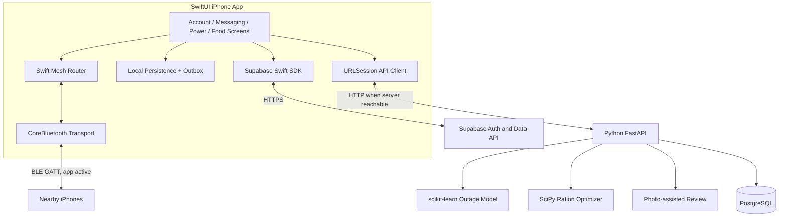
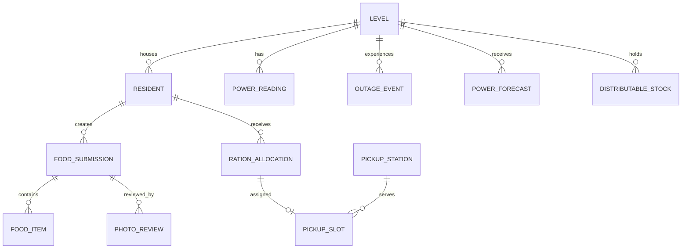

# Hollow — Offline Survival Network

**Status:** The SwiftUI prototype is in `ios/`. The Messages tab implements foreground Bluetooth messaging. The Account tab supports registration, sign-in, and username-based contacts directly through Supabase Auth and the Data API. The Food tab shows a read-only demo pickup window and ration quantities for each resident. The Power tab requests a 24-hour outage forecast for the selected level and shows the server's synthetic replay window.

Bluetooth messaging and previously saved contacts work offline. Registration, sign-in, and contact lookup require a reachable backend. Messages and the device ID are stored locally across relaunches. Power can show labeled offline samples for levels 2 and 3 when the server forecast is unavailable. Food derives sample assignments offline from the account ID, or from the device ID for a guest. Photo capture and review, live power telemetry, and live pickup assignments are pending.

The **Blackout** tab combines family check-ins, resident incident reports, and outage estimates.

Hollow is an **iPhone-first** survival coordination application for an underground civilization with unreliable power, scarce food, and disrupted connectivity. It combines (1) nearby device-to-device messaging, (2) level-specific power outage forecasting, and (3) food inventory, allocation, and pickup scheduling.

## Technology

| Layer | Choice |
| --- | --- |
| iPhone UI | **Swift 5+ and SwiftUI** |
| Device-to-device transport | **CoreBluetooth** (`CBCentralManager`, `CBPeripheralManager`, GATT services/characteristics) |
| Routing | Custom Swift store-and-forward mesh protocol |
| Local storage | SwiftData for the message history, relay queue, and device ID |
| Backend HTTP API | **Python 3.11+ / FastAPI / Pydantic** |
| Database | Supabase Auth and PostgreSQL for accounts; SQLAlchemy and Alembic for the optional Python backend |
| Outage forecasting | pandas, NumPy, scikit-learn |
| Food allocation | Python, SciPy optimization |
| Photo review | Vision-capable model accessed by FastAPI; human review for uncertainty |
| HTTP client | Swift `URLSession` with Codable JSON models |

**Cost and platform:** CoreBluetooth and SwiftUI have no separate Bluetooth API fee. Native iOS builds require **macOS and Xcode**. The team currently has Windows and an iPhone: obtain access to a Mac (borrowed or remote) to compile and deploy. Xcode can install development builds on a personal device using a free Apple account subject to signing/provisioning restrictions; some distribution workflows require paid Apple Developer Program membership. Python/FastAPI can run on Windows.

## System architecture



**Offline boundary:** BLE messaging works without internet or FastAPI. The Food tab shows demo assignments offline. The FastAPI prediction and allocation endpoints require HTTP connectivity.

## Features

### 1. Nearby messaging

The Messages tab lists saved contacts and existing conversations. Open a row to see that device’s chat, or use the compose button to start a conversation by device ID.

- Each foreground iPhone advertises and scans. Peers write chunks with an ATT response to service `742D0001-CCB4-4D28-AE1E-0AA2AAEBE301`, characteristic `742D0002-CCB4-4D28-AE1E-0AA2AAEBE301`. A one-byte flags header marks the first and last chunks. The assembled Codable JSON packet is limited to 4 KiB, with text capped at 240 characters and 960 UTF-8 bytes.
- Messages and acknowledgments have a version, unique ID, origin, destination, creation time, remaining hop allowance, and hop count. Relays store and forward packets that are under 24 hours old and have hops remaining. New packets can cross up to twelve links. Install the updated build on all devices in the relay chain. The updated app can still relay legacy four-link packets. Duplicate messages display once.
- SwiftData stores the on-device history, received acknowledgments, and pending packets. **Queued** means the message is waiting for a peer. **Sent to peer** reflects an accepted Bluetooth write during the current run. **Delivered** requires an acknowledgment addressed to the sender from the destination ID. **Expired** means the forwarding window elapsed without a receipt.
- A device ID is an address. The prototype uses plaintext and has no cryptographic identity verification, so use demo text only.

### 2. Predict power outages by underground level

The backend uses timestamped electrical demand, capacity, and historical outage starts for synthetic levels 2–4. A scikit-learn histogram gradient boosting classifier estimates the probability of at least one outage starting in the 24 hours after the latest input reading. Its inputs include load relative to capacity, the recent change in that ratio, level, and time of day.

Use `GET /api/v1/levels/{level_id}/power/forecast` to replay the bundled sample, `POST` at that path to estimate risk from two submitted readings, and `GET /api/v1/power/model` for held-out evaluation. Model setup and request fields are in the [backend README](backend/hollow-food/README.md). Forecasts are synthetic demonstrations. Outage duration and exact start times are outside this model's output.

### 3. Food inventory and ration distribution

1. Residents register an ID, level, household size, and relevant dietary needs.
2. Residents submit food type, quantity, unit, and a freshly captured photo.
3. Vision-assisted review identifies *visible* items and flags inconsistencies; a photo does **not** prove ownership, true weight, or uniqueness. Ambiguous entries go to human review.
4. Inventory is aggregated by level. Track **privately held** versus **voluntarily contributed/distribution-center-controlled** inventory distinctly. Only distributable inventory enters allocation.
5. SciPy-based allocation uses available stock, household needs, dietary constraints, and minimum provisions; never promise adequate rations when inventory is insufficient.
6. A deterministic scheduler assigns pickup station/time slots using capacity and resident availability.
7. Issue single-use pickup tokens/QR codes; record redemption and prevent duplicate claims. Resolve offline redemption conflicts on synchronization.

**Example endpoints (proposed):**

| Method | Path | Purpose |
| --- | --- | --- |
| `POST` | `/api/v1/residents` | Register resident |
| `POST` | `/api/v1/food/submissions` | Record inventory and photo metadata |
| `POST` | `/api/v1/food/submissions/{id}/photo` | Upload photo for review |
| `GET` | `/api/v1/levels/{id}/food/summary` | Inventory summary by level |
| `POST` | `/api/v1/food/allocations/run` | Authorized allocation job |
| `GET` | `/api/v1/residents/{id}/pickup` | Pickup assignment |
| `POST` | `/api/v1/pickups/{id}/redeem` | Authorized redemption |
| `GET` | `/api/v1/levels/{id}/power/forecast` | Power forecast |

## Data model



Persist timestamps in UTC, use stable IDs, explicit quantity units, audit trails for changes, and separate inventory ownership from physical location.

## Suggested repository layout

```text
hollow/
├── ios/                         # Xcode SwiftUI project
│   ├── HollowApp/
│   │   ├── App/
│   │   ├── Features/Messaging/
│   │   ├── Features/Power/
│   │   ├── Features/Food/
│   │   ├── Networking/
│   │   ├── Persistence/
│   │   └── Models/
│   └── HollowAppTests/
├── backend/
│   ├── app/
│   │   ├── main.py
│   │   ├── api/
│   │   ├── models/
│   │   ├── schemas/
│   │   ├── services/
│   │   └── db/
│   ├── ml/
│   ├── tests/
│   └── requirements.txt
├── data/sample/                 # Synthetic demo data only
├── AGENTS.md
└── README.md
```

## Local development

### Supabase account setup

1. Run [db.sql](db.sql) in the Supabase SQL Editor. It creates profile and contact tables, row-level security policies, and authenticated contact RPCs. Supabase Auth manages its own users and sessions.
2. Enable the **Email** provider and allow new users to sign up in Supabase Authentication. Keep **Confirm email** enabled for verified accounts.
3. Under **Authentication → URL Configuration → Redirect URLs**, add `hollow-auth://callback/confirm` and `hollow-auth://callback/recover`. Use the standard confirmation and recovery email templates. Open the email links on the device that requested them. For email delivery outside Supabase's test sender restrictions, configure custom SMTP.
4. Set `HollowSupabaseURL` and `HollowSupabasePublishableKey` in [ios/HollowApp/Info.plist](ios/HollowApp/Info.plist) to the project's HTTPS URL and `sb_publishable_…` key. Xcode fetches the pinned Supabase Swift package when you open the project.
5. Run Hollow, open **Account**, and choose **Create an account**. Sign up with an email and password, confirm the email, and save a username, name, and level. Each profile is linked to the device's local Bluetooth address. Use separate accounts for separate demo phones.
6. Enter another resident's username under **Contacts**. Tap a saved contact to address a Bluetooth message. The app caches the profile and contacts for offline use and clears them on sign-out.

The iPhone account flow needs only Supabase HTTPS access. Existing accounts from the earlier Python prototype need to register with Supabase Auth and create their profiles again.

The database regression checks in [db.tests.sql](db.tests.sql) can be run in the SQL Editor after applying the schema. The fixture rows are rolled back.

### Food and power backend

Run the FastAPI service locally with Python 3.11 or later. It runs independently of the iPhone app and Supabase.

```sh
cd backend/hollow-food
python -m pip install -r requirements.txt
python -m power.train
python -m unittest discover -s tests
python -m uvicorn api:app --reload
```

Open `http://127.0.0.1:8000/docs` for `POST /food/predict-demand` and `POST /food/allocate`. See the [food backend README](backend/hollow-food/README.md) for model regeneration and input limits.

To connect the iPhone app, set `HollowAPIURL` in [Info.plist](ios/HollowApp/Info.plist) to the base URL, then rebuild and open **Power**. Existing builds configured through `HollowFoodAPIURL` can retain that key as a fallback when `HollowAPIURL` is blank. Use `http://localhost:8000` for a simulator on the same Mac as the server. For a physical phone, use a reachable HTTPS endpoint with a trusted certificate, or run `python -m uvicorn api:app --host 0.0.0.0` on a trusted local network and use the server’s resolvable `.local` hostname, such as `http://hollow-host.local:8000`. Allow local network access if iOS prompts.

Power displays the probability and dated forecast window from the server. The demo replays the latest bundled readings, so the displayed window is historical. Train the model before starting the server with the command above.

The current demo configuration points to `http://MacBook-Air-156.local:8000`. Start Uvicorn with `--host 0.0.0.0` to serve that address. If you run the backend on another Mac, update `HollowAPIURL` before rebuilding.

Try the food prediction and allocation endpoints in the FastAPI docs with synthetic demo data.

### iPhone app (macOS required)

1. On a Mac with Xcode with Swift 6.4 or later (required by the resolved Swift packages), open [Hollow.xcodeproj](ios/Hollow.xcodeproj).
2. Select the **Hollow** scheme and an iPhone simulator running iOS 17 or later. Press Run.
3. For a physical iPhone, select a development team under **Signing & Capabilities**, select the phone as the run destination, then press Run.

### Bluetooth demo

1. Install the app on two physical iPhones, grant Bluetooth permission, and keep both apps in the foreground.
2. Open **Messages** on each phone. Copy or share the recipient’s device ID and tap the sender’s compose button, and paste it into **Recipient device ID**.
3. Turn off Wi-Fi and cellular data while keeping Bluetooth enabled. Send a short message and check that it appears on the recipient and becomes **Delivered** on the sender.
4. For a physical relay check, use a third iPhone. Keep sender and recipient out of direct Bluetooth reach. Let the middle device receive from the sender, then take it into the recipient’s range. Return it to the sender’s range to forward the receipt. Keep the apps foregrounded throughout.

### Blackout Mode demo

1. Save the other resident as a contact on each phone while the network is available. Open **Blackout**, disable Wi-Fi and cellular data, and keep Bluetooth on and both apps in the foreground.
2. Under **Family check-ins**, tap **I’m safe**, **Need supplies**, or **Can’t reach pickup**. The receiver sees the latest check-in and its time. The sender sees **Delivered** after the mesh acknowledgment arrives.
3. Select Level 4 and report **Power out** and **Pickup station closed** for North station. The board shows resident reports alongside model estimates. Reports queue to saved contacts and remain available locally for 24 hours. Bluetooth reports are unverified.

### Food demo

Open **Food** to see a resident’s pickup window and ration quantities. The sample stays consistent for the same account and is available offline when the account is cached. Before sign-in the tab shows a sample for the device.

### Swift checks

The Foundation-only checks run on a Mac with Swift command-line tools. The three-device transport in these checks is a simulation and exercises routing, queue reload, disconnect and reconnect, duplicate suppression, expiry, and acknowledgments.

```sh
hollow_test_dir=$(mktemp -d)
swiftc -module-cache-path "$hollow_test_dir/cache" \
  ios/HollowApp/Models/DemoData.swift \
  ios/HollowApp/Features/Messaging/MeshRouter.swift \
  ios/HollowApp/Networking/PowerAPIClient.swift \
  ios/HollowApp/Features/Blackout/BlackoutMessages.swift \
  ios/HollowApp/Features/Blackout/BlackoutPlanner.swift \
  ios/Tests/main.swift -o "$hollow_test_dir/hollow-tests"
"$hollow_test_dir/hollow-tests"
```

## Seven-day hackathon scope

| Day | Goal |
| --- | --- |
| 1 | SwiftUI navigation, FastAPI skeleton, database, sample data |
| 2 | BLE discovery and two-device messaging |
| 3 | Three-device forwarding, deduplication, message queue |
| 4 | Train/evaluate outage model; display per-level forecast |
| 5 | Food forms, photo capture/upload, review status |
| 6 | Inventory aggregation, allocation, pickup slots and token redemption |
| 7 | Integration, offline tests, failure handling, demo |

**Fallback if only one iPhone is available:** demonstrate routing with a simulated Swift transport and label it explicitly as a simulation; do not claim a real mesh was tested.

## Demo acceptance criteria

- Nearby iPhones can exchange short messages without internet; three devices show a genuine relay if available.
- Offline messages queue without crashing and show truthful status.
- A trained model returns level-specific forecasts with documented evaluation on held-out time periods.
- A food submission includes quantities, units, and a photo; uncertain reviews are not silently approved.
- Private food is never allocated without consent; distributable stock is conserved.
- Every approved allocation gets one pickup slot/token and duplicate redemption is rejected.

## Privacy and safety

Do not publish resident photos or dietary information. Limit access by role; protect API endpoints; encrypt network transport to the backend; avoid logging photo contents. BLE peer identity and message security need explicit threat modeling—proximity alone is not authentication. Do not treat AI photo review as proof or outage predictions as guaranteed warnings.
